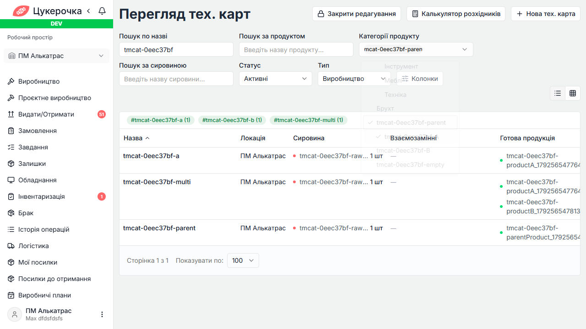
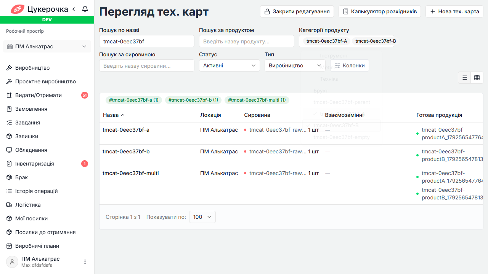
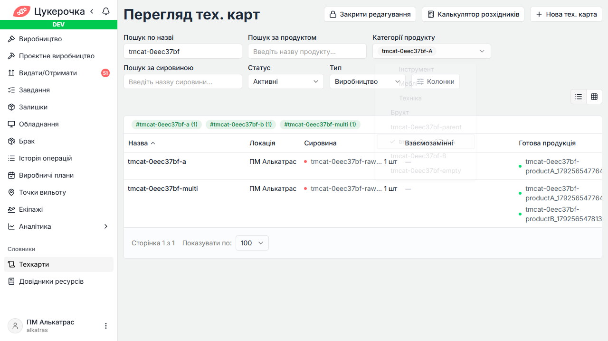
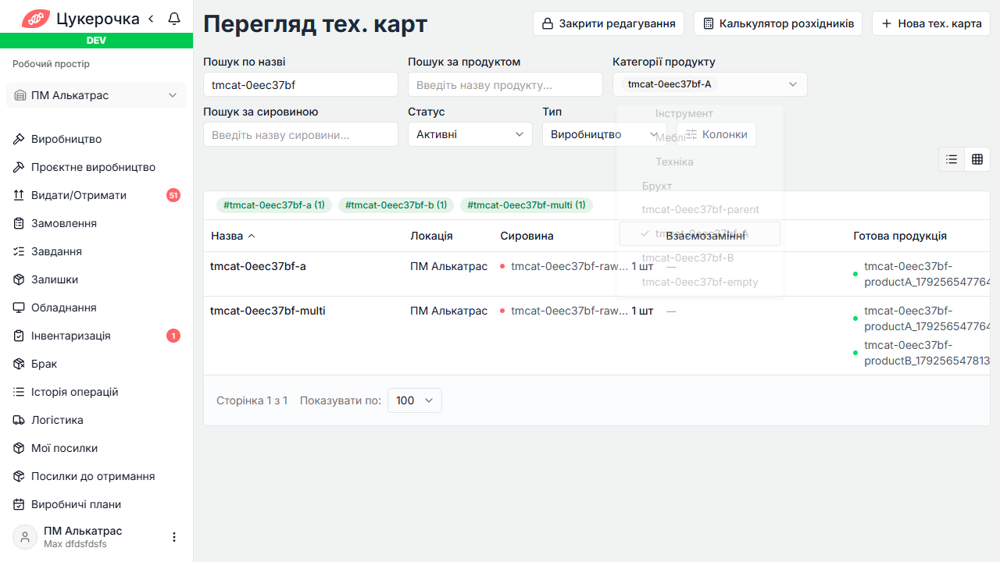
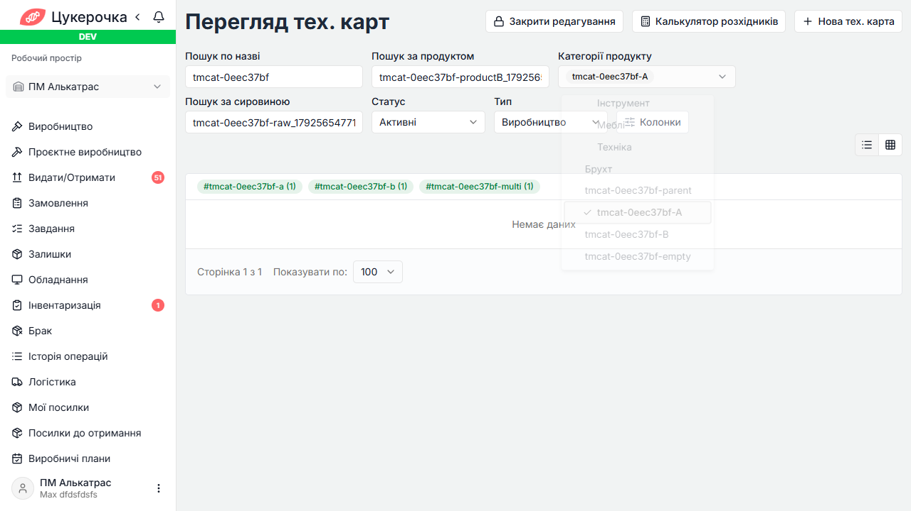

# Техкарти — фільтр категорії виробу: dev

Дата прогону: 2026-10-21. Набір: `tech-map-category-filter`.

Виконань: 14. FAIL: 1, PASS: 13. Помилок setup/cleanup: 0.

TCM: результати цього прогону не імпортовано.

Єдиний дефект: статистика тегів не враховує категорію виробу й повертає тег карти з іншої категорії. Решта API/UI-перевірок фільтра пройшла.

Framework: {'total': 100, 'passed': 100, 'failed': 0, 'skipped': 0}.

Початковий прогін: {'PASS': 11, 'FAIL': 3}. У UI-002/003 виправлено неоднозначний локатор назви: пошук обмежено рядком карти. У підсумку UI-результати замінені повним повтором усіх шести UI-виконань; початкові результати збережено у JSON.

## Результати

### TC-TM-CAT-API-001 (ADMIN) — PASS

Метод: `singleCategoryUsesOutputOnly`; тривалість: 1013 мс.

### TC-TM-CAT-API-001 (OWNER_1) — PASS

Метод: `singleCategoryUsesOutputOnly`; тривалість: 4793 мс.

### TC-TM-CAT-API-002 (ADMIN) — PASS

Метод: `multipleCategoriesReturnDistinctUnion`; тривалість: 622 мс.

### TC-TM-CAT-API-003 (ADMIN) — PASS

Метод: `expandedParentIncludesChildren`; тривалість: 1066 мс.

### TC-TM-CAT-API-004 (ADMIN) — PASS

Метод: `categoryIntersectsOtherSearchFields`; тривалість: 3025 мс.

### TC-TM-CAT-API-005 (ADMIN) — PASS

Метод: `emptyResultClearAndStateTypeIsolation`; тривалість: 2125 мс.

### TC-TM-CAT-API-006 (ADMIN) — PASS

Метод: `paginationCountsFilteredMaps`; тривалість: 1539 мс.

### TC-TM-CAT-API-007 (ADMIN) — FAIL

Метод: `tagStatisticsRespectCategory`; тривалість: 453 мс.

```text
Expecting actual:
  ["#tmcat-3f176d85-a", "#tmcat-3f176d85-b", "#tmcat-3f176d85-multi"]
to contain exactly in any order:
  ["#tmcat-3f176d85-a", "#tmcat-3f176d85-multi"]
but the following elements were unexpected:
  ["#tmcat-3f176d85-b"]
```

### TC-TM-CAT-UI-001 (ADMIN) — PASS

Метод: `singleCategoryFiltersOutput`; тривалість: 5674 мс.

### TC-TM-CAT-UI-001 (OWNER_1) — PASS

Метод: `singleCategoryFiltersOutput`; тривалість: 10952 мс.

### TC-TM-CAT-UI-002 (ADMIN) — PASS

Метод: `multipleSelectionToggleAndClear`; тривалість: 7364 мс.

### TC-TM-CAT-UI-003 (ADMIN) — PASS

Метод: `parentSelectsSubtreeAndChildCanBeRemoved`; тривалість: 5397 мс.

### TC-TM-CAT-UI-004 (ADMIN) — PASS

Метод: `searchIntersectionAndEmptyState`; тривалість: 7093 мс.

### TC-TM-CAT-UI-005 (ADMIN) — PASS

Метод: `selectionSurvivesReloadNavigationAndResetsPage`; тривалість: 8925 мс.

## Докази

- TestNG XML: `target/tm-category-dev-20261021-094650/initial/surefire-reports/testng-results.xml`.
- Maven log: `target/tm-category-dev-20261021-094650/initial/maven.log`.
- [JSON результатів](tech-map-category-dev-results.json).

Очищення власних тестових даних: успішне.

Повтор UI: `target/tm-category-dev-20261021-094650/ui-rerun/surefire-reports/testng-results.xml`.

Framework: `target/tm-category-dev-20261021-094650/framework/surefire-reports/testng-results.xml`.











