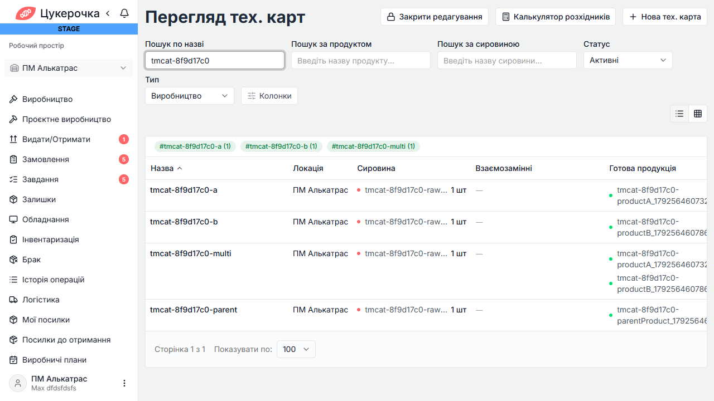
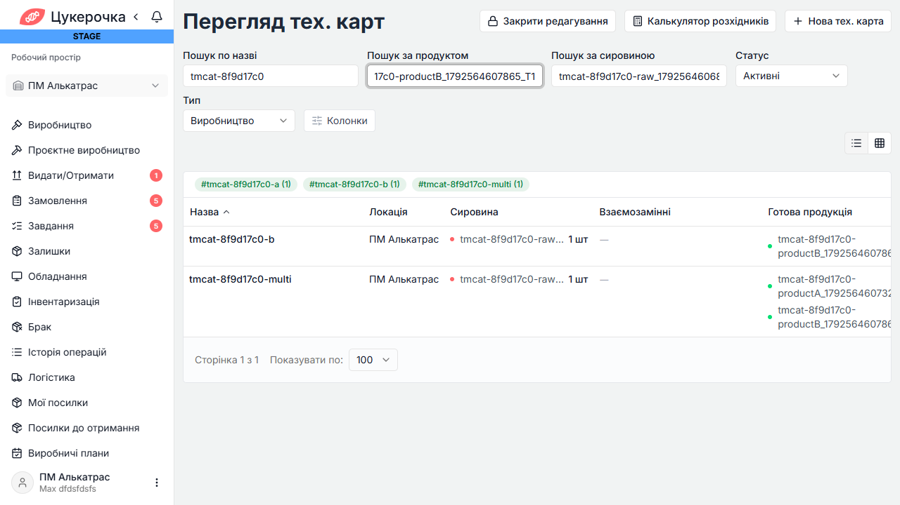
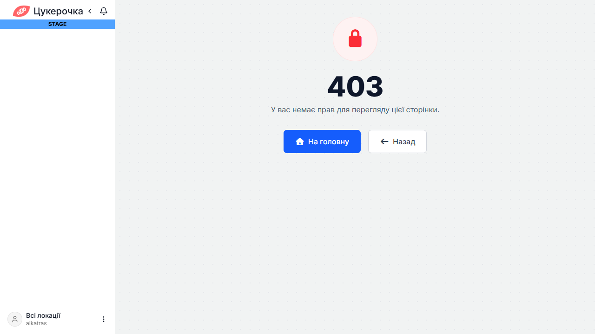

# Техкарти — фільтр категорії виробу: staging

Дата: 21.10.2026. Середовище: https://stage.cukerochka.sbs. TCM: REQ-MFG-001-03, AC-05/AC-06.

12 автоматизованих кейсів, 14 виконань ADMIN/OWNER: {'FAIL': 14}. Помилок setup/cleanup: 0.
Framework: {'total': 100, 'passed': 100, 'failed': 0, 'skipped': 0}; повнота regression.xml: PASS.

TCM: Імпорт результатів у production TCM відхилено автоматичною перевіркою дозволів: payload містить внутрішні URL, діагностику й змінює постійні статуси кейсів. Потрібне явне погодження користувача. Документація та 12 автоматизованих кейсів збережені, статуси цього прогону не імпортовані.

## Висновок

На стейджі фільтр відсутній на екрані, а список API не застосовує categoryIds. Наприклад, для категорії B totalElements=4 замість 2; для порожньої категорії повертаються всі чотири контрольні карти. Тестовий OWNER додатково отримує 403 на список техкарт. Це не успішний прогін фічі.

Статистику тегів повторено з ADMIN, щоб 403 OWNER не приховував перевірку категорії; результат повтору замінює лише API-007 у підсумку. Інші ADMIN/OWNER результати збережено окремо.

Перший запуск у sandbox зупинився до сценаріїв через DNS/Playwright; основний запуск виконано поза sandbox з чинним VPN та встановленим Chrome. Framework також повторено поза sandbox для доступу до localhost.

## Результати

### TC-TM-CAT-API-001 (ADMIN) — FAIL

Метод: `singleCategoryUsesOutputOnly`; тривалість: 592 мс.

```text
Expecting actual:
  [2206L, 2207L, 2209L, 2208L]
to contain exactly in any order:
  [2206L, 2209L]
but the following elements were unexpected:
  [2207L, 2208L]
```

### TC-TM-CAT-API-001 (OWNER_1) — FAIL

Метод: `singleCategoryUsesOutputOnly`; тривалість: 4456 мс.

```text
Fixture setup critical failure: List technological maps as OWNER_1 (status=403, body=Access Denied, request=Request method: GET Request URI: https://stage.cukerochka.sbs/server/api/v1/technological-maps?storageIds=1&page=0&size=100&name=tmcat-85d6d6e3&categoryIds=38&isActive=true&type=PRODUCTION Proxy: <none> Request params: <none> Query params: storageIds=1 page=0 size=100 name=tmcat-85d6d6e3 categoryIds=[38] isActive=true type=PRODUCTION Form params: <none> Path params: <none> Headers: Accept=application/json, application/javascript, text/javascript, text/json Content-Type=application/json Cookies: <redacted> Multiparts: <none> Body: <none>)
```

### TC-TM-CAT-API-002 (ADMIN) — FAIL

Метод: `multipleCategoriesReturnDistinctUnion`; тривалість: 688 мс.

```text
Expecting actual:
  [2206L, 2207L, 2209L, 2208L]
to contain exactly in any order:
  [2206L, 2207L, 2209L]
but the following elements were unexpected:
  [2208L]
```

### TC-TM-CAT-API-003 (ADMIN) — FAIL

Метод: `expandedParentIncludesChildren`; тривалість: 808 мс.

```text
Expecting actual:
  [2206L, 2207L, 2209L, 2208L]
to contain exactly (and in same order):
  [2208L]
but some elements were not expected:
  [2206L, 2207L, 2209L]
```

### TC-TM-CAT-API-004 (ADMIN) — FAIL

Метод: `categoryIntersectsOtherSearchFields`; тривалість: 3226 мс.

```text
[Multi-output карта не поєднує назву одного виходу з категорією іншого]
Expecting empty but was: [2207L, 2209L]
```

### TC-TM-CAT-API-005 (ADMIN) — FAIL

Метод: `emptyResultClearAndStateTypeIsolation`; тривалість: 613 мс.

```text
Expecting empty but was: [2206L, 2207L, 2209L, 2208L]
```

### TC-TM-CAT-API-006 (ADMIN) — FAIL

Метод: `paginationCountsFilteredMaps`; тривалість: 614 мс.

```text
expected: 2L
 but was: 4L
```

### TC-TM-CAT-API-007 (ADMIN) — FAIL

Метод: `tagStatisticsRespectCategory`; тривалість: 632 мс.

```text
Expecting actual:
  ["#tmcat-3767446f-a", "#tmcat-3767446f-b", "#tmcat-3767446f-multi"]
to contain exactly in any order:
  ["#tmcat-3767446f-a", "#tmcat-3767446f-multi"]
but the following elements were unexpected:
  ["#tmcat-3767446f-b"]
```

### TC-TM-CAT-UI-001 (ADMIN) — FAIL

Метод: `singleCategoryFiltersOutput`; тривалість: 10820 мс.

```text
Locator expected to be visible
Call log:
  - Locator.expect with timeout 5000ms
  - waiting for locator("internal:attr=[data-testid=\"technological-maps-filter-categories\"]")
```

### TC-TM-CAT-UI-001 (OWNER_1) — FAIL

Метод: `singleCategoryFiltersOutput`; тривалість: 31689 мс.

```text
Error {
  message='Timeout 30000ms exceeded.
  name='TimeoutError
  stack='TimeoutError: Timeout 30000ms exceeded.
    at ProgressController.run (C:\Users\gigam\AppData\Local\Temp\playwright-java-17654612184582017326\package\lib\server\progress.js:75:26)
    at Frame.waitForSelector (C:\Users\gigam\AppData\Local\Temp\playwright-java-17654612184582017326\package\lib\server\frames.js:628:23)
    at FrameDispatcher.waitForSelector (C:\Users\gigam\AppData\Local\Temp\playwright-java-17654612184582017326\package\lib\server\dispatchers\frameDispatcher.js:107:103)
    at FrameDispatcher._handleCommand (C:\Users\gigam\AppData\Local\Temp\playwright-java-17654612184582017326\package\lib\server\dispatchers\dispatcher.js:94:40)
    at DispatcherConnection.dispatch (C:\Users\gigam\AppData\Local\Temp\playwright-java-17654612184582017326\package\lib\server\dispatchers\dispatcher.js:361:39)
}
Call log:
-   - waiting for getByRole(AriaRole.HEADING, new Page.GetByRoleOptions().setName("Перегляд тех. карт")) to be visible
```

### TC-TM-CAT-UI-002 (ADMIN) — FAIL

Метод: `multipleSelectionToggleAndClear`; тривалість: 35283 мс.

```text
Error {
  message='Timeout 30000ms exceeded.
  name='TimeoutError
  stack='TimeoutError: Timeout 30000ms exceeded.
    at ProgressController.run (C:\Users\gigam\AppData\Local\Temp\playwright-java-17654612184582017326\package\lib\server\progress.js:75:26)
    at Frame.click (C:\Users\gigam\AppData\Local\Temp\playwright-java-17654612184582017326\package\lib\server\frames.js:1021:23)
    at FrameDispatcher.click (C:\Users\gigam\AppData\Local\Temp\playwright-java-17654612184582017326\package\lib\server\dispatchers\frameDispatcher.js:159:30)
    at FrameDispatcher._handleCommand (C:\Users\gigam\AppData\Local\Temp\playwright-java-17654612184582017326\package\lib\server\dispatchers\dispatcher.js:94:40)
    at DispatcherConnection.dispatch (C:\Users\gigam\AppData\Local\Temp\playwright-java-17654612184582017326\package\lib\server\dispatchers\dispatcher.js:361:39)
}
Call log:
-   - waiting for locator("internal:attr=[data-testid=\"technological-maps-filter-categories\"]")
```

### TC-TM-CAT-UI-003 (ADMIN) — FAIL

Метод: `parentSelectsSubtreeAndChildCanBeRemoved`; тривалість: 36169 мс.

```text
Error {
  message='Timeout 30000ms exceeded.
  name='TimeoutError
  stack='TimeoutError: Timeout 30000ms exceeded.
    at ProgressController.run (C:\Users\gigam\AppData\Local\Temp\playwright-java-17654612184582017326\package\lib\server\progress.js:75:26)
    at Frame.click (C:\Users\gigam\AppData\Local\Temp\playwright-java-17654612184582017326\package\lib\server\frames.js:1021:23)
    at FrameDispatcher.click (C:\Users\gigam\AppData\Local\Temp\playwright-java-17654612184582017326\package\lib\server\dispatchers\frameDispatcher.js:159:30)
    at FrameDispatcher._handleCommand (C:\Users\gigam\AppData\Local\Temp\playwright-java-17654612184582017326\package\lib\server\dispatchers\dispatcher.js:94:40)
    at DispatcherConnection.dispatch (C:\Users\gigam\AppData\Local\Temp\playwright-java-17654612184582017326\package\lib\server\dispatchers\dispatcher.js:361:39)
}
Call log:
-   - waiting for locator("internal:attr=[data-testid=\"technological-maps-filter-categories\"]")
```

### TC-TM-CAT-UI-004 (ADMIN) — FAIL

Метод: `searchIntersectionAndEmptyState`; тривалість: 38526 мс.

```text
Error {
  message='Timeout 30000ms exceeded.
  name='TimeoutError
  stack='TimeoutError: Timeout 30000ms exceeded.
    at ProgressController.run (C:\Users\gigam\AppData\Local\Temp\playwright-java-17654612184582017326\package\lib\server\progress.js:75:26)
    at Frame.click (C:\Users\gigam\AppData\Local\Temp\playwright-java-17654612184582017326\package\lib\server\frames.js:1021:23)
    at FrameDispatcher.click (C:\Users\gigam\AppData\Local\Temp\playwright-java-17654612184582017326\package\lib\server\dispatchers\frameDispatcher.js:159:30)
    at FrameDispatcher._handleCommand (C:\Users\gigam\AppData\Local\Temp\playwright-java-17654612184582017326\package\lib\server\dispatchers\dispatcher.js:94:40)
    at DispatcherConnection.dispatch (C:\Users\gigam\AppData\Local\Temp\playwright-java-17654612184582017326\package\lib\server\dispatchers\dispatcher.js:361:39)
}
Call log:
-   - waiting for locator("internal:attr=[data-testid=\"technological-maps-filter-categories\"]")
```

### TC-TM-CAT-UI-005 (ADMIN) — FAIL

Метод: `selectionSurvivesReloadNavigationAndResetsPage`; тривалість: 36849 мс.

```text
Error {
  message='Timeout 30000ms exceeded.
  name='TimeoutError
  stack='TimeoutError: Timeout 30000ms exceeded.
    at ProgressController.run (C:\Users\gigam\AppData\Local\Temp\playwright-java-17654612184582017326\package\lib\server\progress.js:75:26)
    at Frame.click (C:\Users\gigam\AppData\Local\Temp\playwright-java-17654612184582017326\package\lib\server\frames.js:1021:23)
    at FrameDispatcher.click (C:\Users\gigam\AppData\Local\Temp\playwright-java-17654612184582017326\package\lib\server\dispatchers\frameDispatcher.js:159:30)
    at FrameDispatcher._handleCommand (C:\Users\gigam\AppData\Local\Temp\playwright-java-17654612184582017326\package\lib\server\dispatchers\dispatcher.js:94:40)
    at DispatcherConnection.dispatch (C:\Users\gigam\AppData\Local\Temp\playwright-java-17654612184582017326\package\lib\server\dispatchers\dispatcher.js:361:39)
}
Call log:
-   - waiting for locator("internal:attr=[data-testid=\"technological-maps-filter-categories\"]")
```

## Докази й повторний запуск

- Основний TestNG XML: `target/tm-category-staging-retry/surefire-reports/testng-results.xml`.
- Повтор статистики: `target/tm-category-stats/surefire-reports/testng-results.xml`.
- Framework XML: `target/tm-category-framework-retry/surefire-reports/testng-results.xml`.
- JSON результатів: [tech-map-category-staging-results.json](tech-map-category-staging-results.json).
- Вимоги, кейси й команда запуску: [REQ-MFG-CATEGORY-FILTER](../../REQ-MFG-CATEGORY-FILTER.md).

Власні карти/ресурси архівовано, власні категорії видалено; режим редагування локації відновлено. SUT tk/tk-ui не змінювався. Для перевірки реалізованої фічі потрібен стейдж із відповідною версією UI/API.







